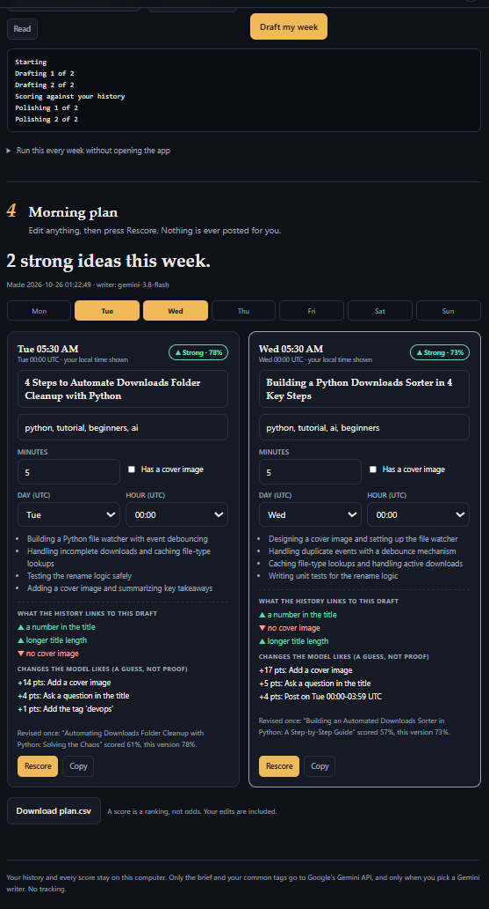
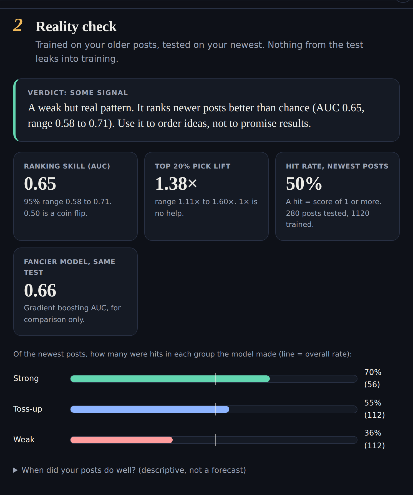

# Siesta 🌙

**Plan next week's posts while you sleep, and find out honestly whether your own history predicts what works.**
If it doesn't, Siesta says so and tells you to go back to sleep.

Runs on your computer. Drafts come from Google's free Gemini API (free key, no card). No telemetry.



## What it does

1. **History.** Upload a CSV (a date, a title, a result such as reactions or likes), or pull
   public posts from DEV by username or tag (DEV's public API needs no key).
2. **Reality check.** A small logistic regression learns from your older posts and is tested on
   your newest 20%. You see ranking skill (ROC AUC) with a 95% bootstrap range, lift for its top
   20% picks, and the measured hit rate of its Strong / Toss-up / Weak groups. If the range
   includes a coin flip, the verdict is "no signal" and drafts stay unranked.
3. **Brief.** Type it, or point Siesta at a git folder or notes file and it reads your recent work.
4. **Plan.** Gemini drafts titles, tags and outlines. Code, not the model, computes every feature
   and score. Non-Strong drafts get one revision that is kept only if it scores higher. Edit
   anything and press Rescore (instant). Download `plan.csv`.

Without a key it falls back to plain templates, so the whole flow still works.



## Run it

Python 3.10 or newer.

```bash
git clone https://github.com/YOUR_USER/siesta.git
cd siesta
python -m venv .venv
source .venv/bin/activate        # Windows: .venv\Scripts\activate
pip install -r requirements.txt
python -m siesta                 # opens http://127.0.0.1:8765
```

No data yet? Press **Just let me try it** in step 1 for made-up demo posts.

### Gemini key (optional, free)

1. Get a key at [aistudio.google.com/apikey](https://aistudio.google.com/apikey).
2. Copy `.env.example` to `.env` and paste it in:

```
GEMINI_API_KEY=your-key
```

A real `GEMINI_API_KEY` environment variable also works and wins over `.env`. `.env` is git-ignored.

Siesta lists the Gemini Flash models your key can use, stable ones first. Google's free tier is
rate limited and sometimes busy or closed to older models, so Siesta retries, then tries the next
model, and only then falls back to templates. The run log says what happened.

### Hands-off weekly run

```bash
python -m siesta run --git ~/code/my-project          # brief from recent commits
python -m siesta run --brief "what I want to write about" --n 5
python -m siesta schedule --day mon --time 02:00 --git ~/code/my-project
```

`schedule` only prints a cron line and a Windows `schtasks` line. It creates nothing.
Plans land in `data/plans/` as JSON and CSV. Open the app in the morning to read the latest one.

## Why this design

- **Auditable.** The judge of your posts is a logistic regression you can read, with the same
  split and settings every run. A hosted black box can't show you why it said no.
- **Mostly private.** Your history and scores stay on the machine. The only network calls are the
  optional DEV fetch and Gemini, which receives your brief, your common tags and the draft being
  revised. Google may use free-tier prompts to improve its products, so keep secrets out of the brief.
- **Free.** Nothing to pay per run on the free tier.
- **Honest limits.** I did not compare draft quality across models. The judge is the same either way.

## Method, fixed in advance

Hit = score at least the median training score (never below 1). Threshold, tag list and scaling come
from training rows only. Test = newest 20% of posts (at least 30). Model = logistic regression
(C=0.5) on weekday, 4-hour window, title length, question, number, tags, reading time, cover. A
gradient-boosting model is shown on the same test for comparison and is never used to score.
Seeds and settings are never tuned on results. The "ideas" are one-change what-ifs from the model:
associations from your history, not proof of cause.

## Limits

- A small history gives wide ranges, and a verdict of "no signal" is the likely, correct answer.
- The demo data is made up and has a planted pattern. It is for trying the app only.
- Hours and days are UTC, with your local time shown next to them.
- DEV posts newer than 14 days are skipped while reactions settle.
- Gemini's free tier changes often (rate limits, which models are open). If drafts fall back to
  templates, read the run log in step 3.

## Tests

```bash
pip install pytest
python -m pytest
```

No key needed. MIT licence, see `LICENSE`.
